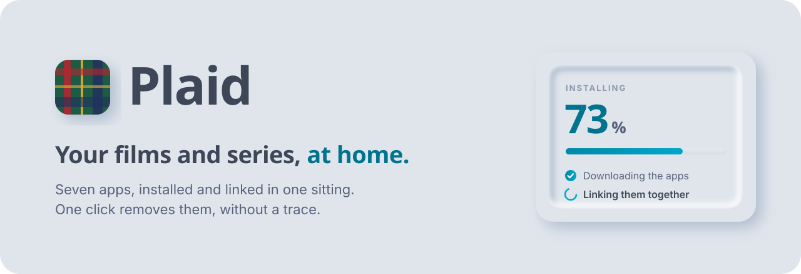
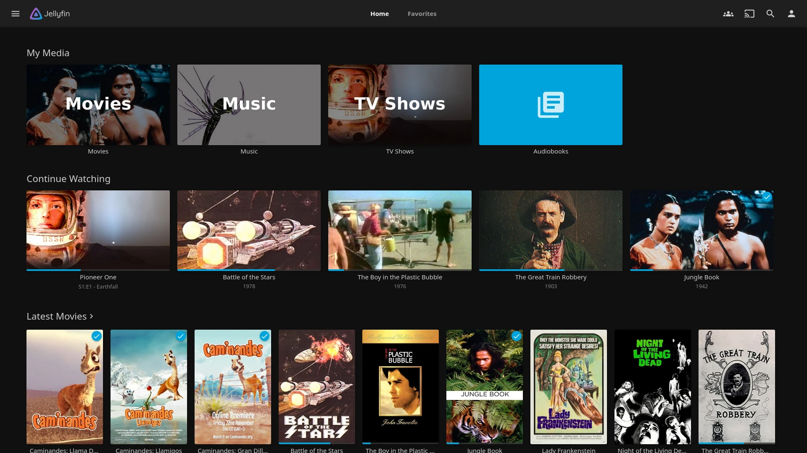
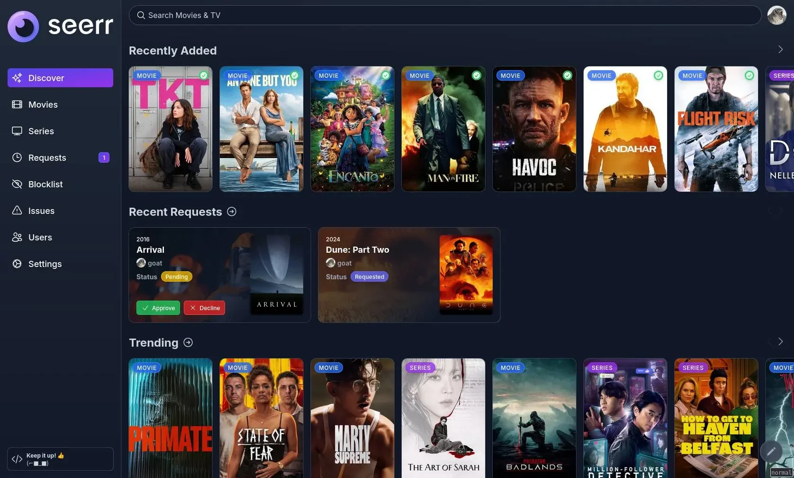
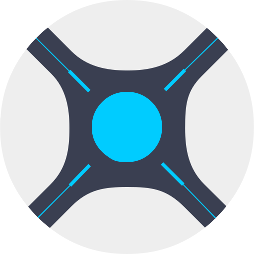
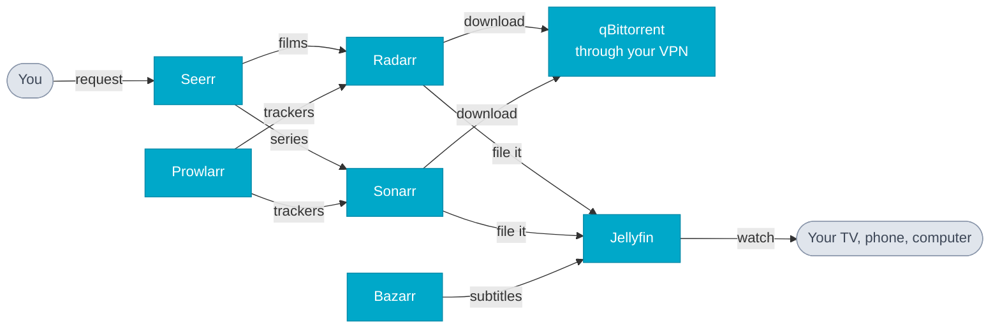

<p align="center">
  <picture>
    <source media="(prefers-color-scheme: dark)" srcset="docs/banner-dark.svg">
    
  </picture>
</p>

<p align="center">
  <a href="https://arimet.github.io/plaid"><strong>Website</strong></a> ·
  <a href="#install"><strong>Install</strong></a> ·
  <a href="#the-seven-apps"><strong>The apps</strong></a> ·
  <a href="#remove"><strong>Remove</strong></a> ·
  <a href="#questions"><strong>Questions</strong></a>
</p>

<p align="center">
  
  
  
</p>

<br>

**Plaid installs a home streaming service in one sitting, and removes it without leaving a trace.** You answer four questions in your browser or your terminal. Plaid installs seven open-source apps, links them together, and gives you the address of each one. Ask for a film from your phone; a few minutes later it plays on your TV.

<p align="center">
  
  
</p>
<p align="center"><sub><b>Jellyfin</b> to watch · <b>Seerr</b> to request</sub></p>

## The ARR stack, set up for you

Radarr, Sonarr, Prowlarr and Bazarr are apps whose names end in *-arr*. Add a downloader and a media player, and they form a streaming service at home that finds, fetches and files your films and series on its own. People call that set the **ARR stack**.

It is powerful, and long to set up by hand. Plaid does the setup.

<table>
<tr>
<th width="50%">By hand</th>
<th width="50%">With Plaid</th>
</tr>
<tr valign="top">
<td>

- Install Docker, then write the configuration of seven containers.
- Choose folders and ports every app agrees on.
- Copy each app's API key into the others.
- Route the downloads through a VPN, and stop them if it drops.
- Find out which two apps do not talk to each other, and why.

</td>
<td>

- ✅ Answer four questions: a folder, a password, your VPN, and remote access if you want it.
- ✅ Plaid installs the seven apps and links them: keys, folders, libraries, quality, subtitles.
- ✅ You get the address of each app, all opened with the same account.
- ✅ One click removes everything.

</td>
</tr>
</table>

## The seven apps

You open two of them. The other five work on their own.

| | App | What it does for you |
|:-:|---|---|
|  | **[Jellyfin](https://jellyfin.org)** | Your own Netflix. Posters, summaries, resume where you stopped. Plays in a browser, on phones, tablets and most smart TVs. |
|  | **[Seerr](https://github.com/seerr-team/seerr)** | A catalogue with a **Request** button. Each person in the house signs in with their Jellyfin account and follows their requests. |
|  | **[Radarr](https://radarr.video)** | Keeps your list of films, picks the best version, then renames and files it where Jellyfin expects it. |
|  | **[Sonarr](https://sonarr.tv)** | The same for series, episode by episode, and fetches new episodes as they come out. |
|  | **[qBittorrent](https://www.qbittorrent.org)** | Does the downloading, through your VPN. If the VPN drops, downloads stop. |
|  | **[Prowlarr](https://prowlarr.com)** | Keeps the list of sites to search, and hands it to Radarr and Sonarr. |
|  | **[Bazarr](https://www.bazarr.media)** | Fetches subtitles in your language and in English, and lines them up with the sound. |

### How they are linked



One username and one password work everywhere. Plaid adds one tracker for you, **Internet Archive**, which only lists public-domain works, so you can try the whole chain legally on day one. [Add your own](#add-your-trackers) when you want.

## Install

> [!TIP]
> **Use a machine that stays on**: a mini PC, a NAS or a Raspberry Pi. Your everyday computer works too, as long as it is on when you watch.

### 🐧 Linux, mini PC, NAS · *recommended*

Open a terminal on the machine (over SSH for a NAS) and paste:

```bash
curl -fsSL https://raw.githubusercontent.com/arimet/plaid/main/launchers/get.sh | sh
```

It installs Docker if it is missing and prints the address of the assistant. Open that address from any computer or phone on your network.

No browser around? Answer the same questions in the terminal:

```bash
curl -fsSL https://raw.githubusercontent.com/arimet/plaid/main/launchers/get.sh | sh -s -- --cli
```

<details>
<summary><b>Synology</b></summary>

1. In DSM, open **Package Center** and install **Container Manager**.
2. In **Control Panel › Terminal & SNMP**, enable SSH.
3. Connect with SSH and run the Linux command above.

Synology support targets x86_64 models on DSM 7.2 or later. It has not been tested on real hardware yet: please open an issue if something goes wrong.

</details>

<details>
<summary><b>Raspberry Pi</b></summary>

A Raspberry Pi 4 or 5 with 4 GB of RAM or more runs the stack with Raspberry Pi OS 64-bit: use the Linux command. Put the system on an SSD rather than a microSD card, and plug your disks into the USB 3 ports. A Pi is too slow for Jellyfin to convert videos on the fly: play files your TV or phone reads directly.

</details>

### 🍎 Mac · 🪟 Windows

1. [Install Docker Desktop](#install-docker-desktop).
2. Download the launcher from the [latest release](https://github.com/arimet/plaid/releases/latest): `Plaid-mac.zip` or `Plaid-windows.zip`.
3. Unzip it and open the launcher:
   - **Mac**: right-click `install.command`, choose **Open**, then **Open** again. macOS asks this the first time, for any file from an unidentified developer.
   - **Windows**: double-click `install.bat`. If SmartScreen warns you, click **More info**, then **Run anyway**.
4. The assistant opens in your browser at <http://localhost:7575>.

<details>
<summary><b id="install-docker-desktop">Install Docker Desktop</b></summary>

Docker Desktop runs the seven apps on Mac and Windows. It installs like any other app.

1. Download it from <https://www.docker.com/products/docker-desktop/> and install it.
2. Windows: accept the WSL 2 update if asked, then restart the PC.
3. Open Docker Desktop once and accept its terms.
4. In **Settings › General**, tick **Start Docker Desktop when you sign in**, or the apps stop when the computer restarts. The launcher tries to tick it for you.

Leave the launcher window open while you install Docker Desktop: it carries on by itself once Docker answers.

</details>

## In the terminal

The `--cli` command shows one step per screen: arrow keys to choose, Enter to confirm, secrets masked as you type.

- **Ctrl-C during the questions** leaves the machine as it was.
- **Ctrl-C during the install** removes everything installed so far.
- **On a machine where Plaid is already installed**, the same command opens a menu instead: your apps and their addresses, add trackers, reach your apps away from home, or remove the stack. Nothing needs a browser.

### Language

Plaid speaks English and French. The terminal version picks from the `LANG` variable of the machine it runs on: French when it starts with `fr` (such as `fr_FR.UTF-8`), English otherwise. To choose, set `LANG` **in front of `sh`**, not in front of `curl`:

```bash
curl -fsSL https://raw.githubusercontent.com/arimet/plaid/main/launchers/get.sh | LANG=fr_FR.UTF-8 sh -s -- --cli
```

Over SSH, a NAS often has no `LANG` set, or `LANG=C`: Plaid then speaks English unless you set it as above. Once Plaid is installed, its terminal menu and its removal keep the language chosen at install. The web assistant has its own EN/FR switch in the top corner.

## Reach your apps away from home

[Tailscale](https://tailscale.com) links your devices in a private network, so your apps answer on your phone or laptop anywhere, without opening anything on your router. It is free for personal use.

<details>
<summary><b>Linux, mini PC, Synology, Raspberry Pi</b>: an optional step in the assistant</summary>

1. Create an account on [tailscale.com](https://tailscale.com) (sign in with Google, Microsoft or Apple).
2. Open [login.tailscale.com › Settings › Keys](https://login.tailscale.com/admin/settings/keys), click **Generate auth key**, leave the options off, and copy the key. It starts with `tskey-auth-` and works once, for 90 days.
3. Paste it in the assistant's **Away from home** step. Plaid joins the machine to your network under the name `plaid`.
4. Install the Tailscale app on your phone or laptop and sign in with the same account.
5. Open `http://plaid:8096` for Jellyfin. Every app answers at `http://plaid:<port>` (see [Ports](#ports)).
6. In [login.tailscale.com › Machines](https://login.tailscale.com/admin/machines), open **plaid › … › Disable key expiry**, or the machine leaves your network after 180 days.

If Tailscale already runs on the machine, leave the key empty: your apps are already reachable through it. Removing the stack also takes `plaid` off your Tailscale network.

</details>

<details>
<summary><b>Mac or Windows</b>: the Tailscale app</summary>

Docker Desktop cannot put a container on your computer's network, so install the Tailscale app instead:

1. Install Tailscale from [tailscale.com/download](https://tailscale.com/download) on this computer and sign in.
2. Install it on your phone with the same account.
3. In the Tailscale app on the computer, note its name (for example `anthony-macbook`).
4. On your phone, open `http://anthony-macbook:8096`. The other apps use their own port.

</details>

### Keep the same address

Plaid shows your apps at the machine's address on your network, such as `http://192.168.1.20:8096`, so they open from the TV, the phone or another computer. Your router may hand the machine a new address one day: in its settings, look for **DHCP reservation** (or "static lease") and reserve the current one for this machine.

## Add your trackers

Public trackers can be added in two clicks from the assistant (**… › Trackers**) or the terminal menu. For the others:

1. Open Prowlarr, then **Indexers › Add Indexer**.
2. Pick a tracker and fill in its fields (your account on that tracker if it asks for one).
3. Click **Test**, then **Save**. Prowlarr hands it to Radarr and Sonarr by itself.

Trackers protected by Cloudflare do not work. To stop using Internet Archive, disable or delete it in the same list. See the [Prowlarr guide](https://wiki.servarr.com/prowlarr/indexers).

## Remove

Open the assistant again (<http://localhost:7575>, or the address printed by the Linux command), sign in, and choose **… › Remove**. It deletes the apps, their settings, your password and the assistant itself. Your media folder is deleted only if you tick the box, which shows its path and size.

From a terminal, run the `--cli` command again and choose **Remove the stack**, or go straight to it:

```bash
curl -fsSL https://raw.githubusercontent.com/arimet/plaid/main/launchers/get.sh | sh -s -- --uninstall
```

Docker stays installed. One small `alpine` image, used for the cleanup itself, may remain: `docker rmi alpine:3.20` removes it.

## Questions

<details>
<summary><b>Is it legal?</b></summary>

Plaid installs free, open-source software. Out of the box it only searches Internet Archive, which lists public-domain works. Any other source you add is your choice and your responsibility, under the laws of your country.

</details>

<details>
<summary><b>Do I need a VPN?</b></summary>

No, but without one your internet provider and other peers see what you download. The assistant asks you to confirm before going on without one. With Proton VPN or Private Internet Access, Plaid also opens a port so downloads find more peers.

</details>

<details>
<summary><b>What if my media disk is unplugged?</b></summary>

Plaid leaves a small hidden file, `.plaid`, in your media folder. Every 30 seconds it checks that the file is there. If the disk is missing, or not mounted yet after a restart, Jellyfin, Radarr, Sonarr, qBittorrent and Bazarr stay stopped, so nothing gets marked as missing or downloaded onto the system disk. The assistant and the terminal menu say so, and the apps start again on their own once the disk is back. If the folder has files but no `.plaid` (a library copied to a new disk, say), Plaid asks you to confirm it is the right folder.

</details>

<details>
<summary><b>What if the VPN drops?</b></summary>

qBittorrent stops downloading: it only reaches the internet through the VPN, so nothing leaks. The assistant shows "VPN disconnected" until it is back. When the VPN restarts on its own, Plaid restarts qBittorrent with it, so downloads pick up again.

</details>

<details>
<summary><b>Can I change a setting later?</b></summary>

Plaid installs and removes. To change a setting (new VPN key, other folder), remove the stack and install it again: your media folder can stay. Each app's own settings stay editable in the app.

</details>

<details>
<summary><b>Does Plaid update the apps?</b></summary>

No. No 4K profile and no FlareSolverr either, for now.

</details>

## Ports

| Assistant | Jellyfin | Seerr | Radarr | Sonarr | qBittorrent | Prowlarr | Bazarr |
|:-:|:-:|:-:|:-:|:-:|:-:|:-:|:-:|
| 7575 | 8096 | 5055 | 7878 | 8989 | 8080 | 9696 | 6767 |

## How it works

The assistant is Python (standard library only) running in its own small container, talking to Docker through its socket. It writes one Compose file, starts the seven apps, then links them through their APIs: qBittorrent's API key into Radarr and Sonarr, Prowlarr's trackers synced to both, Jellyfin libraries created and refreshed on import, Seerr signed in through Jellyfin. Removal runs in a detached container, so it can also delete the assistant itself. Docker restarts the assistant at boot; the assistant then starts the five apps that read the media folder, once it sees the disk.

<details>
<summary><b>Development</b></summary>

```bash
python3 -m unittest                                   # unit tests
ARR_LIVE=1 python3 -m unittest tests.test_apps_live   # starts a real stack and checks every link
python3 tests/demo.py 7700                            # the assistant with a simulated install
python3 tests/demo_cli.py linux                       # the terminal version with a simulated install
docker build -t plaid:dev . && PLAID_IMAGE=plaid:dev ./launchers/install.command
```

The landing page lives in `site/`, a single HTML file with no build step.

</details>

## Licence

MIT. App logos belong to their projects (see `installer/static/icons/NOTICE.md`).

<p align="center"><sub>Made by <a href="https://arimet.github.io">Anthony</a></sub></p>
